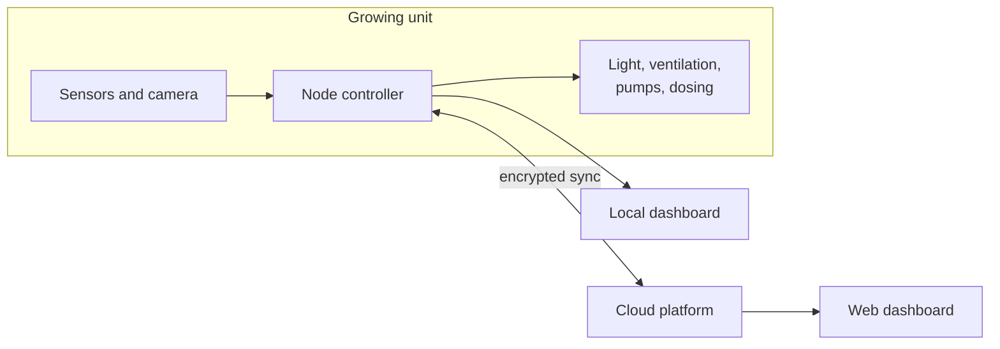

# How It Works

GreenThumb has three parts: a **node** in each growing unit, a **cloud platform** that gathers the data from every node, and **dashboards** for growers and researchers.

## The node

Each unit is controlled by a single-board computer. On a fixed cycle it reads its sensors, compares the readings with the rules for the crop and its current growth phase, and switches its actuators. It stores everything locally first, so a lost internet connection never stops a cultivation.

## The cloud platform

The cloud keeps the history of every node, the crop catalog and the user accounts. Nodes pull their configuration from it and push their measurements, events and photos to it.

## Design principles

1. **Offline-first.** A node is fully autonomous; the cloud adds history and remote management, not control.
2. **Hardware as data.** Which part is connected where is configuration, not code, so a unit can be rewired or extended without new software.
3. **Rule-based control with safety limits.** Thresholds, schedules and intervals drive the actuators, and hard limits plus a watchdog keep the unit safe if anything misbehaves.
4. **One data model everywhere.** Nodes and the cloud share the same definitions, so data from any unit is directly comparable.
5. **Private by default.** Nodes and the cloud platform are not exposed to the public internet; they communicate over an encrypted private network.

## Built with

Raspberry Pi, Python, PostgreSQL with TimescaleDB, React and Docker.
